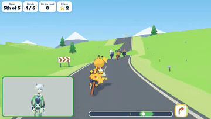

# Camera Games

Movement-based games for children, played in front of a webcam.

| | |
|---|---|
|  **High Five Racers:** open hand to drive |  **Balloon Pop:** open hand to pop |
|  **Mighty Moves:** fight with whole-body moves |  **Leap Trail:** jump and step side to side |
|  **Sky Wings:** fly with your arms |  **Robot Rescue:** open to fire, close to shield |
|  **Tank Patrol:** close to drive, open to fire |  **Cannon Bay:** steer a ship with one hand |
|  **Long Walk Home:** carry fruit to a hungry giraffe |  **Spider Catcher:** catch spiders, take them home |
|  **Smoothie Stand:** slice fruit with an open hand |  **Lighthouse Keeper:** wipe the windows clean |
|  **Bounce Back:** hit a big, slow ball over the net with an open hand |  **Giraffe's Maze:** lead Giraffe through a maze with an open hand |
|  **Giraffe's Garden:** turn your hand over to water the garden |  **Giraffe's Goal:** save penalties with your hand held up like a high five |
|  **Frost Arena:** a team shooter in the snow for grown-up players, played with two hands in the air like two thumbs on a phone: an open hand is a thumb on the glass, dragged to walk on one side and to look round on the other, a closed one is a thumb lifted, and a thumb up fires |  **Arrow Meadow:** archery with both hands: one holds the bow, the other pulls the string back and opens to let the arrow fly |
|  **Giraffe's Puzzles:** put Giraffe's broken picture back together, carrying each piece with an open hand |  **Flap, Little Chick!:** bend your wrists back to flap a chick's wings, and fly it home before the fox |
|  **Mighty Lift:** raise your arm to lift heavy things off your friends |  **Gobble and Grow:** open your mouth wide to gobble things up, and grow from a bacterium into a galaxy |
|  **Giraffe's Paint Box:** colour in pictures with your open hand as the brush |  **Moto Mountain:** lean your body into the bends to race a motorbike up a mountain, flying off the hills |
|  **Rooftop Rope:** stand on one leg to walk the ropes between the rooftops of a city | |

- Resting never costs anything.
- Each game has 10 levels.
- Play with friends on their own computers in 22 of the games: make a game on the title card and send them the link or its 3-letter code. Mighty Moves, Bounce Back, Tank Patrol and Cannon Bay are for two, and Frost Arena, Arrow Meadow, Giraffe's Puzzles, Flap, Little Chick!, Mighty Lift, Gobble and Grow, Giraffe's Paint Box, Moto Mountain and Rooftop Rope for up to four, together or against each other as whoever makes the game chooses, and the rest are everyone playing in the same game.
- Gobble and Grow is played with the mouth, Mighty Lift by raising an arm, Flap, Little Chick! by bending the wrists back, Moto Mountain by leaning the body to the side, and Rooftop Rope by standing on one leg.
- A grown-up can change the settings under the gear icon, including which hand shape makes a game's move, like pointing instead of an open hand.
- The camera picture stays on your computer. The site counts visits with Google Analytics.

## Play

Open **<https://hemi.infoicy.com>** in Google Chrome on a computer with a webcam.

Full details: [readme-details.md](readme-details.md)
